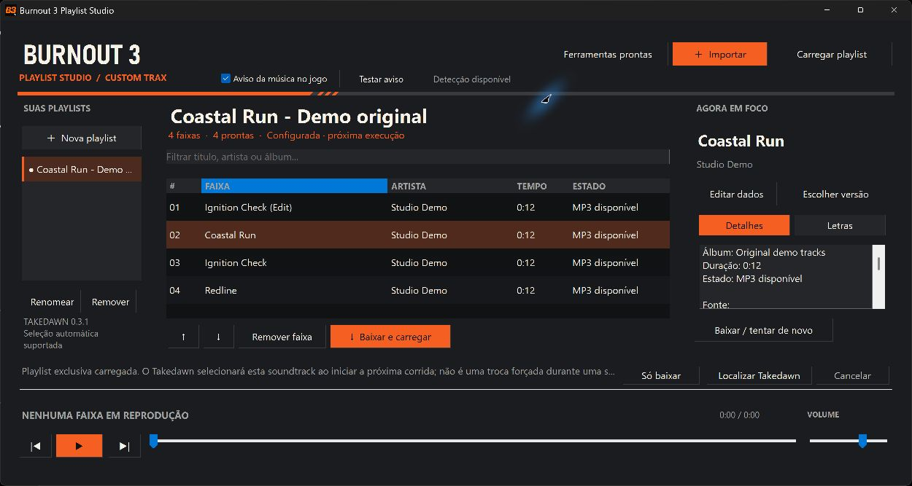
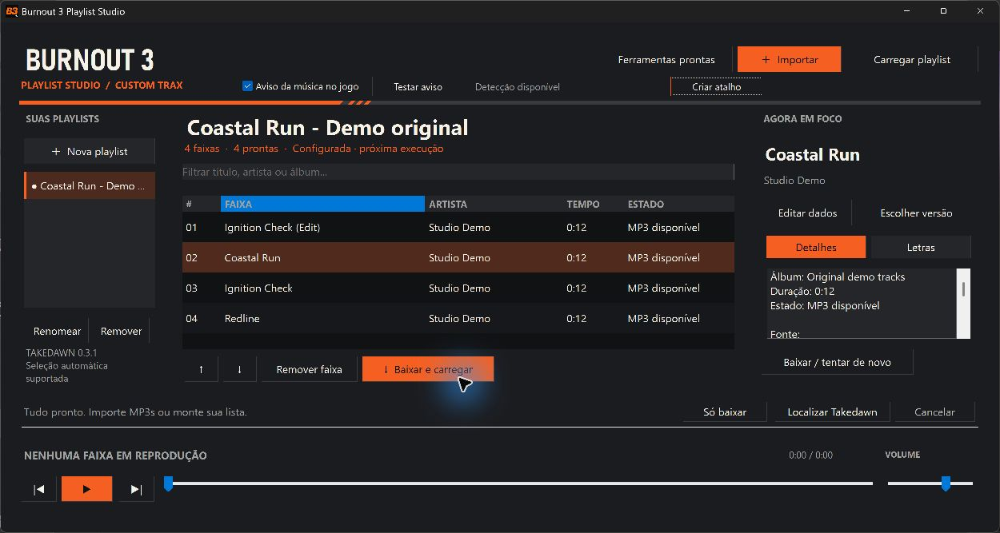
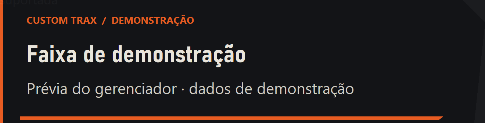
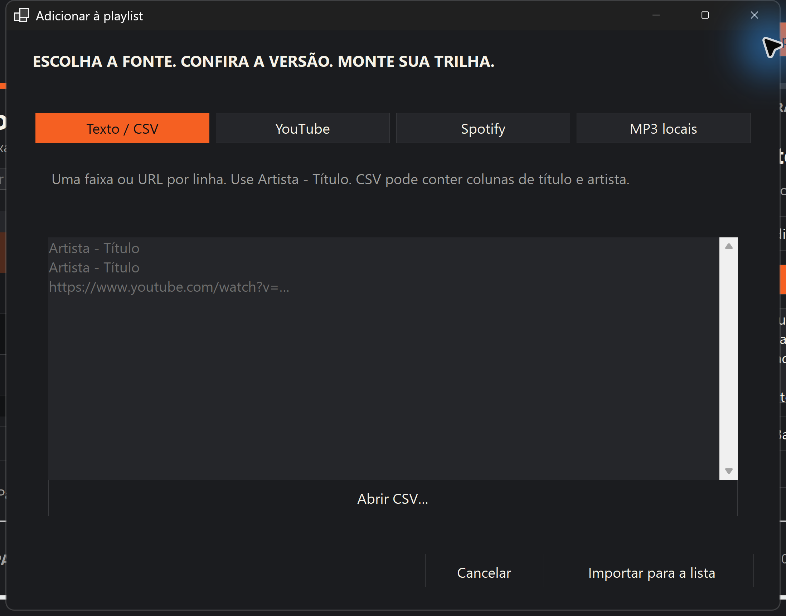
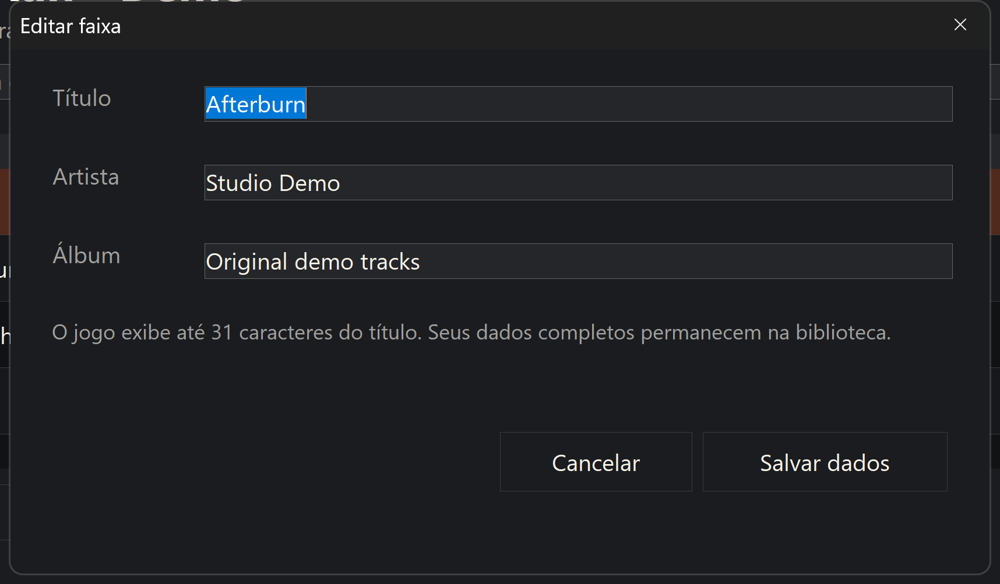

# Burnout 3 Playlist Studio

**Your music. Your playlist. Your next takedown.**

[](https://github.com/eep0x10/burnout3-playlist-studio/actions/workflows/build.yml)

A portable Windows playlist manager for **Burnout 3 Recomp / Takedawn**. Build a library from song names, YouTube links, public Spotify playlist metadata or local audio. Prepare MP3s, find available lyrics, edit tracks, and load one isolated playlist into the game.

[Português brasileiro](README.pt-BR.md) · [Download for Windows x64](https://github.com/eep0x10/burnout3-playlist-studio/releases/latest) · [Report an issue](https://github.com/eep0x10/burnout3-playlist-studio/issues)



The interface currently uses Brazilian Portuguese. Screenshots show original synthesized demo tracks; the download starts with an empty library.

## Quick start

1. Download the portable ZIP from **Releases** and extract the entire folder somewhere writable.
2. Run `BurnoutPlaylistStudio.exe`. No .NET installation or administrator account is required.
3. Create a playlist with **Nova playlist**, then use **Importar** to add songs, links, a public Spotify playlist, CSV or local audio.
4. Check titles and artists. **Escolher versão** lets you select a different YouTube match.
5. Close Takedawn. Use **Baixar e carregar** to prepare the tracks and activate that playlist, or **Carregar playlist** for tracks already prepared.
6. For automatic selection, use **Takedawn 0.2.1 or later**. On **0.2.0**, select the custom soundtrack manually in **EA GAMES TRAX → X → A** each time you launch the game.

The first preparation downloads verified copies of **yt-dlp**, **FFmpeg/ffprobe**, and **Deno** from their upstream sources. These stay in the portable `tools/` folder. Downloads require internet and additional disk space.

## Start and close together with Takedawn

In **1.1.3 or later**, create the shortcut inside the manager:

1. Extract the entire portable folder and run `BurnoutPlaylistStudio.exe`.
2. Click **Criar atalho** (Create shortcut) and select your installed `Takedawn.exe`.
3. Use **Takedawn + Playlist Studio**, created on your desktop. The manager opens minimized with notifications enabled and closes when you exit the game. Creating the shortcut does not launch the game.



The app asks before replacing a shortcut with the same name. If you move either application, use **Criar atalho** again to update the paths.

### Manual alternative (1.1.2 or later)

The package includes `Launch-Takedawn.vbs`. To configure it yourself:

1. Extract the ZIP and keep `Launch-Takedawn.vbs` beside `BurnoutPlaylistStudio.exe`.
2. Right-click your Windows desktop → **New → Shortcut**.
3. Paste the target below, replacing both example paths with your actual manager and `Takedawn.exe` locations. Keep the quotation marks:

   ```text
   %SystemRoot%\System32\wscript.exe "C:\Games\Playlist Studio\Launch-Takedawn.vbs" "C:\Games\Takedawn\Takedawn.exe"
   ```

4. Name it **Takedawn + Playlist Studio**. Optionally select `Takedawn.exe` under **Properties → Change Icon**.
5. Use this shortcut to play. It starts the manager **minimized**, enables track notifications and launches Takedawn. An already-open manager for the same data folder is reused.
6. When Takedawn exits, the manager closes automatically. Active downloads and other operations are cancelled and allowed to finish cleanup; the manager is not forcibly terminated.

To edit playlists independently, run **`BurnoutPlaylistStudio.exe` directly**. Use the combined shortcut for automatic startup/shutdown; running `Takedawn.exe` alone bypasses this integration. The launcher follows the game process it starts, including when the manager was already open beforehand.

Do not double-click the `.vbs` without supplying the game path. Use folders without percent signs. Update the shortcut if you move either application. The launcher requires Windows Script Host (`wscript.exe`); if it is disabled on your PC, open both apps manually. No Windows startup entry is installed. [Notification details and limits](docs/NOW_PLAYING.md).

## Track-change notification

Keep the manager open and enable **Aviso da música no jogo**. A title/artist popup appears at the lower-left when a managed MP3 is detected in the foreground Takedawn window. You can minimize the manager and use **Testar aviso** for a labelled preview without opening the game.

**Start both with one click:** `Launch-Takedawn.vbs` starts the manager minimized with notifications enabled, then launches the game. Version 1.1.2 also closes the manager when the game exits, allowing active operations to finish cleanup. [Shortcut setup](docs/NOW_PLAYING.md#start-together-with-takedawn-111).

This is an external, game-style notification, not a patch to the native HUD. It reads only file-handle metadata for managed audio; no game-memory capture or verbose diagnostics are required. Stable file detection can take one or two seconds and cannot confirm audible output or pause. Fullscreen gameplay still requires user validation. [How it works and limits](docs/NOW_PLAYING.md).



## One active playlist

Loading creates a separate, managed snapshot containing only the selected playlist's ready MP3s. Takedawn points directly to this folder, so other playlists in your library are excluded. Activation refuses empty or unfinished playlists instead of silently falling back to a different list.

On supported versions, the app configures `custom_music_dir`, `custom_music_at_start = true`, and the textual `custom_music_soundtrack` name, with a backup of the previous settings. On older or unknown versions it reports manual selection clearly. You can still change the soundtrack inside the game; this is not a permanent lock. Movie/cutscene audio is not replaced.

The app does not modify game ROMs or saves. Keep Takedawn closed while loading a new soundtrack, then restart Takedawn. Moving the portable folder requires loading the playlist again to update the game path.

## Manage your library

- Create, rename and remove playlists; add/remove tracks and filter the list.
- Reorder tracks with ↑ / ↓ and edit title, artist and album.
- Download MP3 audio from a YouTube video or resolve a song name to a candidate.
- Import YouTube playlists and visible metadata from public Spotify playlists.
- Import local MP3, WAV, FLAC or Ogg files without changing the originals.
- Play/pause, seek, skip tracks and adjust volume.
- Read synchronized or plain lyrics when LRCLIB has a matching entry.
- Watch progress, cancel processing and retry failed tracks.

| Add songs | Edit track information |
| --- | --- |
|  |  |

**Só baixar** prepares audio without loading it into the game. The core also supports managed exports for the traditional multi-soundtrack folder workflow.

### Spotify and text imports

Spotify supplies names/artists, **not audio**. Public pages may omit tracks; the import reports its count and unconfirmed completeness. No Spotify credentials are required for public-page import. The core also has an authorized API integration for developers, but this GUI has no Spotify login flow.

Use one `Artist - Title` or YouTube URL per line. CSV accepts commas or semicolons and headers such as `Title`, `Artist`, `Album`, `Track Name`, `Artist Name(s)`, `Album Name`, or `YouTube URL`:

```csv
Title,Artist,Album
My Track,My Artist,My Playlist
```

### Lyrics

Lyrics are best effort. Missing lyrics or a provider failure does not discard a valid MP3. The app shows whether an entry is synchronized, plain, instrumental, unavailable or failed. `.lrc` / `.txt` sidecars are for the manager and external tools; **there is no in-game lyrics overlay**.

## Compatibility and limits

- Windows x64; native WinForms application, currently PT-BR.
- Takedawn **0.2.1+** for automatic startup selection; **0.2.0** uses manual selection.
- Game soundtrack limits: 100 soundtracks, 500 tracks each; in-game titles display up to 31 Latin-1 characters. Full metadata remains in the library.
- Per-video download limits: 30 minutes and approximately 250 MB.
- The selected custom soundtrack replaces the regular music source; it does not mix with all other playlists. Player menu changes and unsupported game modes can affect playback.
- Use audio you are authorized to download and play. No DRM, CAPTCHA or account restrictions are bypassed.

Official references: [custom music](https://github.com/xenophobentx/takedawn/blob/v0.3.1/docs/custom-music.md), [startup selection behaviour](https://github.com/xenophobentx/takedawn/blob/v0.3.1/src/game/soundtrack_start.h), [Takedawn releases](https://github.com/xenophobentx/takedawn/releases).

## Portable data and backups

Move the EXE together with `data/` and `tools/`. Prepared audio, lyrics and library state live under `data/`; verified tool receipts live under `tools/`. Installed exports elsewhere do not move automatically.

Settings are backed up before changes. Export reconciliation checks ownership and hashes, preserving unmanaged or manually changed files. Removing a track from the catalog requires synchronization/loading again to update the game. Deleting a catalog playlist does not automatically delete previously exported folders or original files.

Network access is limited to requested operations: YouTube for matches/audio, Spotify for playlist metadata, LRCLIB for lyrics, GitHub/Gyan for tool downloads. There is no project-operated telemetry service. Never share your `data/` folder or account tokens in public issues.

## Build and contribute

Requires Windows and **.NET SDK 10**:

```powershell
dotnet run --project Tests/Burnout3.PlaylistStudio.Tests.csproj -c Release
./build.ps1
```

The self-contained `win-x64` build is written to `dist/`. CI runs isolated tests and uploads a portable build. `App/` contains WinForms; `Core/` owns library, imports, downloads, activation and installation. See [contributing](CONTRIBUTING.md) and [verification notes](docs/VERIFICATION.md).

For an isolated demonstration:

```powershell
./dist/BurnoutPlaylistStudio.exe --data C:/Demo/Studio/data --config C:/Demo/Studio/settings.toml
```

Choose a separate test music folder as well. Do not use personal game settings during development.

## License

[MIT](LICENSE). See [third-party notices](THIRD_PARTY_NOTICES.md) and bundled .NET notices. Independent fan utility, not affiliated with EA, Criterion, Spotify, YouTube or the Takedawn team. No game, ROM, commercial music or third-party lyrics are included.
