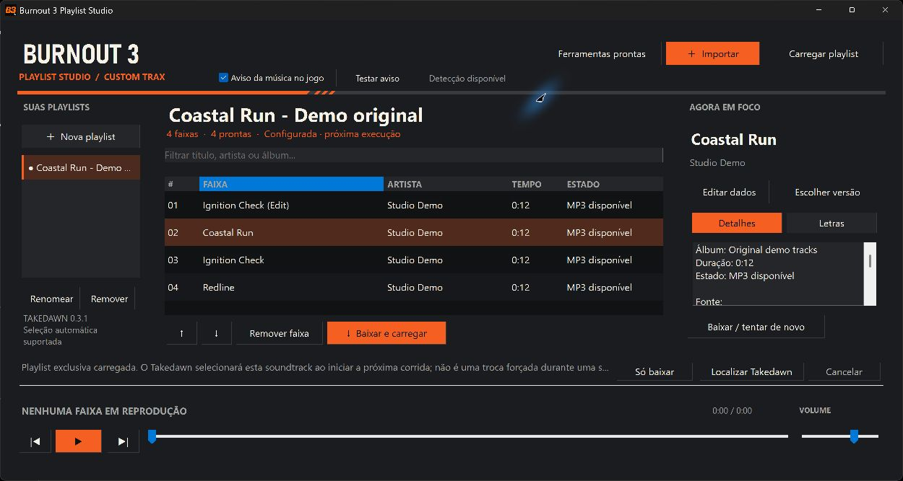
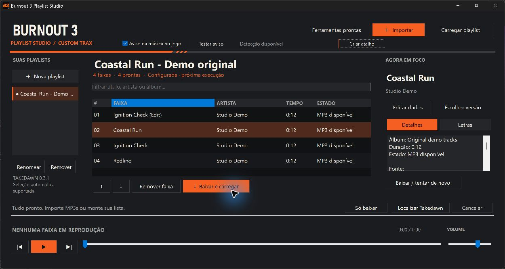
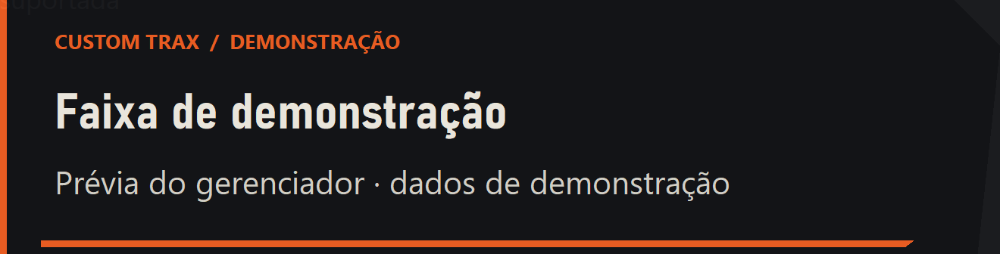
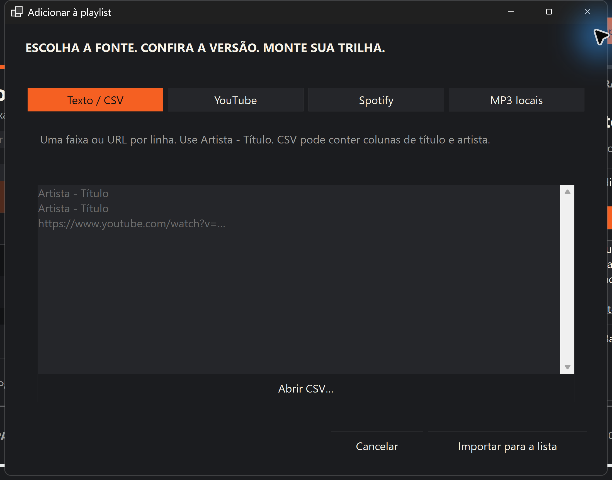
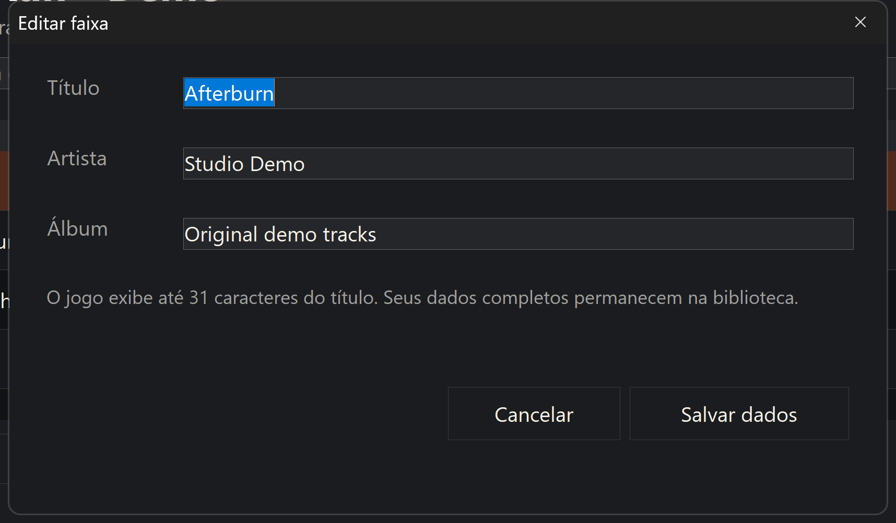

# Burnout 3 Playlist Studio

**Monte sua trilha. Organize sua biblioteca. Leve suas playlists ao Takedawn.**

[](https://github.com/eep0x10/burnout3-playlist-studio/actions/workflows/build.yml)

Gerenciador portable para Windows, com tema escuro inspirado nas pistas de Burnout 3. Organiza faixas, procura versões no YouTube, prepara MP3s, busca letras e exporta playlists para o sistema de músicas customizadas do **Burnout 3 Recomp / Takedawn**.

[English](README.md) · [Baixar para Windows x64](https://github.com/eep0x10/burnout3-playlist-studio/releases/latest)



As capturas usam faixas originais sintetizadas para demonstração. A biblioteca do download começa vazia.

## Começar

1. Extraia **toda a pasta** do ZIP em um local onde você possa gravar arquivos.
2. Abra `BurnoutPlaylistStudio.exe`. Não precisa instalar o .NET.
3. Crie uma playlist e clique em **Importar**. Adicione nomes de músicas, links do YouTube, uma playlist pública do Spotify, arquivos locais ou CSV.
4. As faixas são preparadas automaticamente após a importação, com MP3 e letras quando disponíveis. Aguarde o resultado; não há uma etapa separada de baixar.
5. Com o Takedawn fechado, clique em **Usar no jogo** para escolher a playlist ativa. **Atualizar** consulta a playlist de origem e prepara as mudanças. Na primeira utilização, o aplicativo prepara yt-dlp, FFmpeg e Deno nas fontes oficiais; isso requer internet e espaço adicional.
6. No **Takedawn 0.2.1 ou mais recente**, a playlist fica configurada para seleção automática na próxima execução. No **0.2.0**, selecione-a manualmente em **EA GAMES TRAX → X → A** a cada execução.

Arquivos locais MP3, WAV, FLAC e Ogg também podem ser usados; os originais são preservados. Importar outra playlist não troca a trilha ativa sem você escolher **Usar no jogo**.

## Sincronizar com YouTube e Spotify

**Desde a versão 1.2.1, o atalho integrado sincroniza a playlist ativa antes de abrir o Takedawn.** Ele mostra o progresso, baixa/prepara as mudanças e só depois inicia o jogo com o gerenciador minimizado. Não precisa clicar em Atualizar antes de jogar. Cancelar ou uma falha impede a abertura; lista parcial pede confirmação para continuar com a seleção preservada.

- Importe o **link da playlist**, não apenas os links de vídeos individuais. A origem fica salva na biblioteca.
- Clique em **Atualizar** depois de editar a lista no YouTube/Spotify. O programa identifica novas faixas, baixa e prepara automaticamente o áudio e as letras disponíveis. Não é necessário clicar em um botão de download.
- Uma leitura completa da origem também acompanha exclusões e ordem. Leituras parciais ou com erro preservam as faixas ausentes e mostram um aviso, para não apagar músicas por engano.
- Para uma playlist antiga sem origem salva, use **Fonte…** para vincular a URL uma vez. Músicas adicionadas manualmente continuam independentes da origem.
- Remover faixas ou playlists limpa as cópias gerenciadas correspondentes. Arquivos locais originais, arquivos desconhecidos e cópias alteradas externamente são preservados; limitações de limpeza são informadas.
- Com o Takedawn aberto, a atualização da trilha ativa e a limpeza de arquivos usados pelo jogo ficam pendentes. A preparação pode continuar, mas o programa não fecha nem reinicia o jogo por você.

O botão **Atualizar** permite antecipar essa consulta sem iniciar o jogo. A abertura pelo atalho faz isso automaticamente; abrir `Takedawn.exe` diretamente ignora essa etapa. Não há um serviço de sincronização permanente. A página pública do Spotify pode ser incompleta, então ela não autoriza excluir faixas ausentes. [Funcionamento, acesso Spotify e limites](docs/SYNC.md).

## Abrir e fechar junto com o Takedawn

Na versão **1.1.3 ou mais recente**, o próprio gerenciador cria o atalho:

1. Extraia toda a pasta do portable e abra `BurnoutPlaylistStudio.exe`.
2. Clique em **Criar atalho** e escolha o `Takedawn.exe` instalado no seu PC.
3. Use **Takedawn + Playlist Studio**, criado na Área de Trabalho. O gerenciador abre minimizado com os avisos ativos e fecha quando você sair do jogo. Criar o atalho não abre o jogo.



Se já existir um atalho com esse nome, o aplicativo pede confirmação antes de substituí-lo. Se mover o jogo ou o portable, clique em **Criar atalho** novamente para atualizar os caminhos.

### Alternativa manual (1.1.2 ou mais recente)

O pacote inclui `Launch-Takedawn.vbs`. Se preferir configurar por conta própria:

1. Extraia o ZIP e mantenha `Launch-Takedawn.vbs` na mesma pasta de `BurnoutPlaylistStudio.exe`.
2. Na Área de Trabalho, clique com o botão direito → **Novo → Atalho**.
3. Em **Digite o local do item**, cole o comando abaixo, trocando os dois caminhos pelos locais do seu gerenciador e do seu `Takedawn.exe`. Preserve as aspas:

   ```text
   %SystemRoot%\System32\wscript.exe "C:\Jogos\Playlist Studio\Launch-Takedawn.vbs" "C:\Jogos\Takedawn\Takedawn.exe"
   ```

4. Nomeie o atalho como **Takedawn + Playlist Studio**. Se desejar, em **Propriedades → Alterar ícone**, selecione o `Takedawn.exe`.
5. Use esse atalho para jogar. Ele abre o gerenciador **minimizado**, habilita **Aviso da música no jogo** e inicia o Takedawn. Se o gerenciador já estiver aberto, reutiliza a instância da mesma pasta de dados.
6. Ao fechar o Takedawn, o gerenciador fecha automaticamente. Downloads e outras operações em andamento são cancelados e aguardam a limpeza antes de sair; o gerenciador não é encerrado à força.

Para editar playlists sem abrir o jogo, abra **`BurnoutPlaylistStudio.exe` diretamente**. Para jogar com o ciclo automático de abertura e fechamento, use o atalho acima; abrir apenas `Takedawn.exe` não ativa essa integração. O gerenciador acompanha o processo iniciado pelo atalho, inclusive se já estava aberto antes.

Não dê duplo clique no `.vbs` sem configurar o caminho do jogo. Use pastas sem `%` no nome. Se mover o portable ou o jogo, atualize o destino do atalho. O lançador usa o Windows Script Host (`wscript.exe`); em PCs onde ele estiver desativado, abra os dois aplicativos manualmente. Nada é instalado na inicialização do Windows. [Detalhes e limites do aviso](docs/NOW_PLAYING.md).

## Aviso ao trocar de música

Mantenha o gerenciador aberto e marque **Aviso da música no jogo**. Um popup com título e artista aparece no canto inferior esquerdo quando um MP3 gerenciado é detectado no Takedawn em primeiro plano. Pode minimizar o gerenciador. **Testar aviso** mostra uma prévia identificada como demonstração, sem abrir o jogo.

**Abrir os dois com um clique:** `Launch-Takedawn.vbs` abre o gerenciador minimizado com os avisos ativos e inicia o jogo. Na versão 1.1.2, também fecha o gerenciador ao sair do jogo, aguardando a limpeza de operações em andamento. [Como configurar o atalho](docs/NOW_PLAYING.md#start-together-with-takedawn-111).

É um aviso externo no estilo do jogo, sem alterar o HUD nativo, os saves ou o executável. A detecção consulta apenas os arquivos gerenciados abertos pelo Takedawn, sem capturar memória nem habilitar diagnóstico completo. Pode levar um ou dois segundos e não confirma audibilidade ou pausa. A aparência sobre o jogo em tela cheia ainda depende de teste do usuário. [Detalhes e limites](docs/NOW_PLAYING.md).



## Apenas a playlist escolhida

Carregar cria uma cópia gerenciada isolada, contendo somente os MP3s da playlist selecionada. O jogo aponta diretamente para essa pasta; as outras playlists da biblioteca ficam de fora. Listas vazias ou com faixas ainda não preparadas são recusadas.

Em versões compatíveis, são configurados `custom_music_dir`, `custom_music_at_start = true` e o nome textual de `custom_music_soundtrack`, com backup das configurações anteriores. Em versões antigas ou desconhecidas, o aplicativo informa a seleção manual necessária. Isso não impede que você troque a trilha pelo menu do jogo, nem substitui áudio de filmes/cutscenes.

## Sua biblioteca

- Criar, renomear e remover playlists; adicionar e remover faixas.
- Filtrar músicas e alterar a ordem com ↑ / ↓.
- Editar título, artista e álbum; a preparação das alterações ocorre automaticamente.
- Escolher uma correspondência do YouTube quando a primeira versão não for a desejada.
- Acompanhar processamento, cancelar e tentar novamente uma faixa que falhou.
- Ouvir MP3s, pausar, avançar, voltar, ajustar posição e volume.
- Consultar letras sincronizadas ou simples quando disponíveis no LRCLIB.

| Adicionar músicas | Editar metadados |
| --- | --- |
|  |  |

## Importações

| Entrada | Comportamento |
| --- | --- |
| `Artista - Título` | Uma faixa por linha; busca áudio no YouTube. |
| Link de vídeo do YouTube | Usa o vídeo informado. |
| Playlist do YouTube | Importa entradas disponíveis. |
| Playlist pública do Spotify | Lê nomes e artistas visíveis; busca áudio no YouTube. |
| CSV / texto | Alternativa para listas indisponíveis pela página pública. |
| Arquivos locais | Prepara uma cópia em MP3; preserva os originais. |

O Spotify **não fornece áudio ao aplicativo**: nomes e artistas são usados para buscar uma correspondência no YouTube. A página pública pode omitir entradas e não permite confirmar integralidade; o aplicativo informa essa limitação e preserva faixas ausentes. O acesso completo pela API oficial exige autorização compatível; veja [sincronização](docs/SYNC.md).

CSV aceita vírgula ou ponto e vírgula, com cabeçalhos `Title`, `Artist`, `Album` (também reconhece `Track Name`, `Artist Name(s)` e `Album Name`). Exemplo:

```csv
Title,Artist,Album
Minha faixa,Meu artista,Minha playlist
```

## Integração com o Takedawn

Formato de músicas customizadas do Takedawn:

- Cada subpasta da raiz é um soundtrack; até **100 soundtracks** e **500 músicas por soundtrack** no jogo.
- Arquivos recebem números para preservar a ordem.
- Títulos no jogo têm limite de **31 caracteres Latin-1**. A biblioteca mantém os nomes completos.
- Configurações ficam em `%APPDATA%\Takedawn\settings.toml`. A seleção automática exige **0.2.1+**; o aplicativo detecta a versão antes de configurar esse recurso.
- Também é possível selecionar a raiz em **F1 → Audio → Custom music folder**.

As letras ficam no gerenciador e em `.lrc` / `.txt`. **Não há integração de letras na tela do jogo.** A versão 0.2.0 exige selecionar a playlist no menu a cada execução. Música de split screen e outros modos depende das opções e suporte do próprio jogo.

A sincronização identifica seus arquivos por manifesto e hash, preservando arquivos desconhecidos ou modificados manualmente. Backups ficam em `PlaylistStudio-Backups`, ao lado da raiz de músicas. ROMs e saves não são alterados.

Alterações na playlist ativa geram uma atualização da cópia do jogo quando ele estiver fechado. Exclusões limpam somente arquivos identificados como gerenciados pelo aplicativo; arquivos originais, de terceiros ou alterados manualmente continuam preservados. Trabalho pendente é mantido para nova tentativa.

Referências: [músicas customizadas](https://github.com/xenophobentx/takedawn/blob/v0.3.1/docs/custom-music.md), [seleção na inicialização](https://github.com/xenophobentx/takedawn/blob/v0.3.1/src/game/soundtrack_start.h) e [atualizações oficiais](https://github.com/xenophobentx/takedawn/releases).

## Portable e privacidade

Mova estas pastas junto com o executável:

```text
BurnoutPlaylistStudio.exe
data/       biblioteca, áudio preparado, letras e fila
tools/      ferramentas e manifesto de verificação
```

Não exige administrador nem instala dependências globalmente. O primeiro preparo inclui downloads grandes, especialmente FFmpeg. Músicas exportadas ficam na pasta escolhida e não se movem junto com o EXE.

Buscas e áudio acessam YouTube; letras acessam LRCLIB; importação Spotify acessa Spotify; ferramentas vêm de GitHub e Gyan. Não há telemetria própria. Use conteúdo que você tenha autorização para baixar e utilizar.

## Limites e problemas comuns

- **Vídeo indisponível / login / bloqueio:** escolha outra versão ou importe arquivo local. O aplicativo não contorna DRM, CAPTCHA ou restrições de conta.
- **Correspondência errada:** use **Escolher versão** e confira título, artista e duração.
- **Letra ausente:** o MP3 continua funcionando. Nem toda música possui letra ou timestamps no provedor.
- **Spotify parcial:** importe os nomes por CSV/texto.
- **Jogo não mostra músicas:** confira a raiz, selecione o soundtrack no EA GAMES TRAX e reinicie o jogo.
- **Ferramentas não preparam:** confira internet e permissão de gravação. Downloads são verificados antes da execução.
- **Limites por faixa:** até 30 minutos e aproximadamente 250 MB por download; o jogo possui os limites acima.

## Desenvolvimento

Requer Windows e **.NET SDK 10**:

```powershell
dotnet run --project Tests/Burnout3.PlaylistStudio.Tests.csproj -c Release
./build.ps1
```

O resultado self-contained `win-x64` fica em `dist/`. `App/` contém WinForms; `Core/` contém biblioteca, importações, fila e instalação. Os testes usam pastas temporárias e configuração isolada. Para abrir uma biblioteca de teste:

```powershell
./dist/BurnoutPlaylistStudio.exe --data C:/Demo/Studio/data --config C:/Demo/Studio/settings.toml
```

Configure a pasta de músicas separadamente nessa biblioteca de teste.

## Licença

Aplicativo sob [MIT](LICENSE). Veja [avisos de terceiros](THIRD_PARTY_NOTICES.md). Projeto independente, sem afiliação à EA, Criterion, Spotify, YouTube ou equipe do Takedawn. Não inclui jogo, ROM, músicas comerciais ou letras de terceiros.
