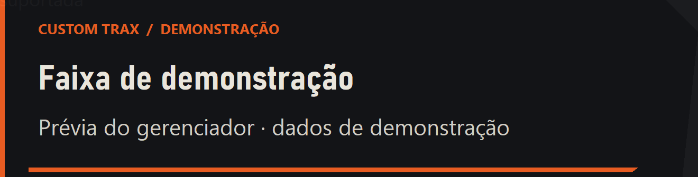

# Aviso de música / Now playing

Feature introduced in 1.1.0. This is a notification drawn by Playlist Studio, not the game's native HUD.

## Using the notification

Enable **Aviso da música no jogo** and keep the manager open while playing. You may minimize it. When a managed MP3 is detected, a short title/artist notification appears at the lower-left of the foreground Takedawn window. **Testar aviso** shows a clearly labelled demonstration without opening the game.

The style is inspired by the original track-change banner, using the manager's charcoal, warm white and orange identity. No EA logo or game artwork is bundled. The notification shows title and artist, not lyrics or playback progress.

## Behaviour and limits

- Notifications last approximately six seconds. A new event replaces the previous one.
- Placement follows the game window/monitor and Windows DPI, with safe margins.
- The window does not take focus or intercept clicks. It hides when you switch to another app.
- Fade animation follows the Windows client-area animation preference.
- Turning the feature off or closing the manager stops observation and removes the popup.
- The popup needs this manager's active, managed playlist. Unknown external songs are not guessed from a playlist clock.

## Detection boundary

Detection reads file-handle metadata only from Takedawn and compares it with exact active-manifest MP3 paths. No game patch, injected code, process-memory capture, music-byte reading or verbose game logging is required. It does not launch Takedawn or change its settings/saves.

The observer polls once per second and requires a stable candidate for at least 750 ms. Short file opens during scanning are ignored; multiple simultaneous candidates suppress notifications rather than selecting one arbitrarily. This can delay a popup by roughly one or two seconds. A file remaining open does not prove audible output or pause state. Reopening the same file after an observed gap permits another notification; a restart entirely between polls may be missed.

## Verification

The 84-check suite includes real Windows handle capture in the test process and a separate synthetic child, exact path matching, closing/reopening and rejection of a non-Takedawn process by the production reader. Other fixtures cover mapping, debounce and ambiguous candidates. No game process was opened for these tests.

The preview window was captured on the desktop with demonstration data. Foreground remained the manager during its approximately six-second lifetime; the popup was shown without activating its own window. Native topmost positioning and alpha updates are used directly to avoid WinForms activation/visibility side effects.

The actual fullscreen/gameplay appearance still requires a user test. The notification is external to the renderer and may not appear in capture software configured to record only the game's renderer. For diagnostic details and visual preview evidence, see [verification](VERIFICATION.md) and the native UI decision record.
