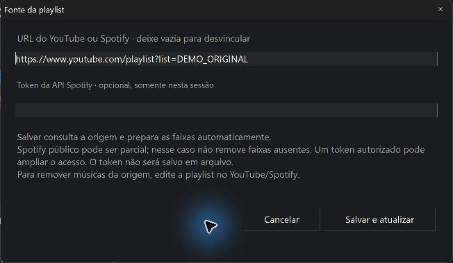

# Sincronização / Playlist sync

Introduzida na versão **1.2.0**. O gerenciador prepara o áudio automaticamente; **Atualizar** consulta a plataforma. Não existe uma etapa separada de download, nem um serviço que consulta suas contas com o gerenciador fechado.

## Fluxo recomendado

1. Crie uma playlist e importe a URL da playlist do YouTube ou Spotify. A origem fica salva. Texto, CSV e arquivos locais continuam disponíveis para listas sem vínculo remoto.
2. Aguarde a preparação automática. Confira as versões encontradas, erros e letras disponíveis. Se precisar escolher outra correspondência do YouTube, use **Escolher versão**; a nova versão é preparada automaticamente.
3. Com o Takedawn fechado, clique em **Usar no jogo** para escolher a trilha ativa. Importar outra lista não muda essa escolha.
4. Edite sua playlist na plataforma e clique em **Atualizar** no gerenciador. Ele busca a lista atual e prepara as faixas novas sem outro botão.
5. Para vincular uma playlist antiga, use **Fonte…**. Deixar a URL vazia desfaz o vínculo; não existe como reconstruir automaticamente uma URL de playlist que a versão antiga não salvou.

## O que uma atualização muda

Uma resposta completa da origem permite acompanhar entradas novas, remoções e ordem. Faixas que continuam na lista mantêm sua identidade e seus arquivos preparados, evitando baixar tudo novamente. Músicas adicionadas manualmente permanecem independentes do vínculo.

Uma resposta parcial, um vídeo indisponível, uma interrupção de paginação ou erro de acesso **não prova uma exclusão**. O programa preserva as faixas ausentes e mostra a limitação. Excluir uma playlist na plataforma ou torná-la privada também pode parecer uma falha de acesso; para apagar suas cópias locais, remova a playlist no gerenciador.

O aplicativo não altera suas playlists no YouTube/Spotify. Remover uma faixa vinculada apenas no gerenciador pode fazer com que ela reapareça em **Atualizar**, caso ainda esteja na lista de origem. Para uma remoção permanente na origem, edite a lista na plataforma.

## Spotify: leitura pública e API

O Spotify fornece metadados, **não áudio**. Título e artista são usados para procurar uma correspondência no YouTube; ela pode precisar de revisão em **Escolher versão**.

A página pública/embed pode omitir faixas e não oferece um contrato de paginação completa. Esse modo pode acrescentar músicas encontradas, mas não remove as que ficaram ausentes. A interface informa a integralidade não confirmada.

Em **Fonte…**, o campo opcional de token permite usar um acesso autorizado à API Spotify. O token fica somente na sessão do gerenciador, não é salvo na biblioteca e deve ter acesso à playlist. Não há login OAuth integrado nem token compartilhado com o portable. A API pode negar acesso, expirar a autorização ou limitar o aplicativo; nesse caso, as faixas existentes são preservadas.

As restrições atuais da API, paginação e autorização estão nas referências oficiais de [Get Playlist Items](https://developer.spotify.com/documentation/web-api/reference/get-playlists-items) e [Get Playlist](https://developer.spotify.com/documentation/web-api/reference/get-playlist). O contrato de [oEmbed](https://developer.spotify.com/documentation/embeds/reference/oembed) descreve o player/metadados, sem garantir a lista completa.

## Remoção de arquivos

Remover uma música ou playlist agenda a limpeza dos MP3s, letras e exportações identificados como gerenciados pelo programa. O arquivo local original usado na importação nunca é o alvo dessa limpeza. Caminhos externos, links/junções, arquivos desconhecidos ou alterados fora do gerenciador são preservados e podem gerar um aviso.

Um arquivo ainda usado como origem por outra faixa é preservado até a última referência ser removida. Caches legados sem prova de propriedade e backups históricos de recuperação não são varridos indiscriminadamente; a limpeza pode deixar pastas vazias e manifestos. A nova exclusão não cria cópias permanentes dos MP3s apagados.

Se a playlist ativa ficar vazia ou for removida, a configuração da trilha customizada pertencente ao gerenciador é desativada com o jogo fechado. Outras configurações e saves são preservados. Arquivos bloqueados ou trabalho interrompido permanecem pendentes para nova tentativa.

## Takedawn aberto e trabalho pendente

A preparação pode acontecer com o Takedawn aberto, mas a pasta ativa, suas músicas em uso e a configuração do jogo não são trocadas durante essa sessão. A interface mostra a aplicação pendente. Com o jogo fechado, o gerenciador pode concluir o trabalho local pendente; **Atualizar** também permite tentar novamente. Nenhum jogo é aberto, fechado ou reiniciado pelo sincronizador.

O atalho integrado continua abrindo o gerenciador minimizado e fechando-o ao sair do Takedawn. Esse encerramento cancela operações em andamento com limpeza; uma atualização remota incompleta não autoriza apagar músicas.

## Atualizar um portable existente

Feche o gerenciador e faça uma cópia da sua pasta `data` antes de atualizar. Extraia os arquivos de programa da versão nova sobre a mesma pasta, preservando `data` e `tools`. As bibliotecas antigas continuam disponíveis; vínculos de origem ausentes precisam ser informados em **Fonte…**. Não use uma versão antiga para gravar uma biblioteca já atualizada, pois ela pode descartar os campos novos de sincronização. Para reverter, restaure o programa e a cópia de dados correspondentes juntos.

## English overview

Import a playlist URL to retain its source. Imports and local edits prepare audio automatically. **Atualizar** refreshes that source; **Usar no jogo** chooses the active game soundtrack. Use **Fonte…** to link older libraries or supply an optional session-only authorized Spotify token. Complete source snapshots reconcile deletions/order; partial public Spotify responses never authorize absence-based deletion. Only owned managed files are cleaned up, never local originals. Game export changes are deferred while Takedawn is running; there is no closed-manager background service.
