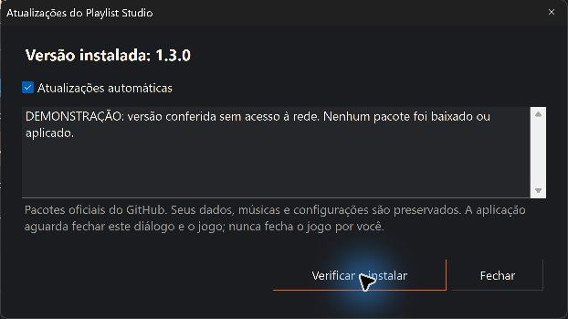

# Atualização automática do portable

A partir da **versão 1.3.0**, o Playlist Studio consulta os releases estáveis de [eep0x10/burnout3-playlist-studio](https://github.com/eep0x10/burnout3-playlist-studio/releases). A opção automática vem ativada. Não há serviço, tarefa agendada, inicialização com o Windows ou necessidade de administrador.

Quem ainda usa 1.2.x precisa baixar 1.3.0 ou mais recente uma vez, mantendo `data` e `tools` na pasta existente. Depois dessa instalação inicial, as próximas versões estáveis podem ser recebidas automaticamente.

## Como funciona

1. Abra o gerenciador normalmente. A consulta acontece em segundo plano, sem bloquear o uso da biblioteca.
2. Se houver uma versão estável mais nova, o programa baixa o ZIP e o arquivo de checksums correspondentes e verifica o SHA-256 antes de preparar a instalação.
3. Quando estiver ocioso, sem diálogo/operação em andamento e com o Takedawn fechado, ele fecha com segurança, atualiza os arquivos do programa e reinicia o gerenciador.
4. Se estiver acompanhando uma partida pelo atalho integrado, não interrompe o jogo: pode preparar a atualização, mas aguarda o fechamento normal do gerenciador para aplicar. Nesse caso, não reabre a janela depois de sair do jogo.

O sincronizador de músicas antes da abertura do jogo continua separado: ele não verifica nem instala versões do programa. O atualizador nunca abre, fecha ou reinicia o Takedawn.

## Controles

Use **Atualizações** no rodapé para ver o estado, ativar/desativar as atualizações automáticas ou escolher **Verificar e instalar** manualmente. A ação manual continua disponível com o automático desativado. Uma janela aberta ou operação pendente pode adiar a instalação; feche os diálogos quando quiser permitir a troca segura.

Falhas de internet, limite da API do GitHub ou ausência de uma versão nova não impedem o uso da biblioteca. Em caso de erro, consulte o estado em Atualizações. Não é necessário fornecer senha ou token GitHub.

## Dados preservados

A substituição abrange somente arquivos de programa aprovados: executável, lançador integrado, documentação, imagens e avisos de licença. Não instala conteúdos do ZIP em `data` ou `tools`, não substitui músicas, playlists, letras ou configurações do usuário e não altera saves/configuração do Takedawn. As opções já existentes do gerenciador são mantidas ao salvar a nova preferência automática.

Credenciais que já eram somente de sessão, como o token Spotify opcional, não se tornam persistentes por causa do atualizador e precisam ser informadas novamente após fechar/reiniciar o aplicativo.

O processo verifica caminhos e rejeita travessia de diretórios, links/junções, arquivos inesperados e colisões. Uma outra instância em uso ou arquivo alterado pode impedir a instalação; o programa adia ou informa a falha em vez de encerrar processos à força.

## Backup e recuperação

Antes de trocar os arquivos aprovados, o atualizador mantém cópias verificadas da versão anterior. O processo auxiliar aguarda a saída da instância correta, usando PID e data de criação, e tenta reverter as substituições se ocorrer uma falha. Uma versão que falhou entra em espera para evitar ciclos de atualização e reinício.

Se a reversão também não puder concluir, consulte a mensagem e os caminhos de recuperação registrados pelo atualizador. Preserve os backups e sua pasta `data`; não extraia um ZIP desconhecido por cima da biblioteca. Para uma recuperação manual, feche todas as instâncias e restaure apenas os arquivos de programa indicados no backup. O backup do programa não é um backup das músicas: mantenha uma cópia independente de seus dados importantes.

## Integridade e limites

São usados apenas releases estáveis do repositório fixo, com nome/versão do asset esperado e checksum correspondente. Drafts, pré-lançamentos e versões iguais/anteriores não provocam atualização. O executável preparado deve corresponder à versão do release.

O SHA-256 confirma a integridade do pacote dentro do canal autorizado; **não é uma assinatura digital independente** nem protege contra comprometimento da conta que publica o repositório. A pasta portable precisa permitir gravação. A atualização automática se destina ao EXE portable distribuído, não a uma execução pelo SDK/dotnet durante desenvolvimento.

## English overview

Version 1.3.0+ checks this repository's stable GitHub releases in the background. **Atualizações** controls the automatic preference and manual check/install. Verified program files are replaced only after safe shutdown, with backup and attempted rollback. User `data`, music, `tools` and game saves/config remain outside replacement. Companion/game sessions defer installation until normal close without reopening the manager; ordinary idle Studio sessions can restart after update. Helpers and prelaunch music synchronization never check for software updates. Offline errors are nonblocking. SHA256 provides release-channel integrity, not an independent digital signature.
